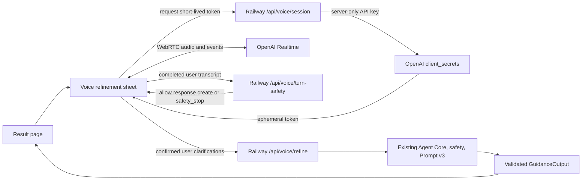

# Realtime Voice Refinement Plan

## Conclusion

Add voice as a **post-analysis refinement session**, not as a replacement for the
existing structured relationship analysis.

- `gpt-realtime-2.1-mini` handles low-latency spoken clarification and rehearsal.
- The current Agent Core, Prompt v3, evidence validation, deterministic safety, and
  selected text model produce the revised final guidance.
- The existing MCP tool remains the competition's machine-evaluation entry. Realtime
  audio is a WebRTC product experience and should not be routed through MCP.

This hybrid design gives the user a natural conversation while preserving quoted chat
evidence, explicit uncertainty, truthful provenance, deterministic risk handling, and
one shared output contract.

## Why not use one voice model for everything

OpenAI documents two voice-agent architectures: direct speech-to-speech for natural,
low-latency conversation, and a chained pipeline for predictable workflows that need
explicit control over transcription and text reasoning. This application needs both.

Realtime models support function calling but do not support Structured Outputs. A
Realtime response therefore must not directly become the authoritative
`GuidanceOutput`. The voice layer may ask questions and rehearse wording; the existing
structured pipeline must re-run before the UI replaces evidence, risk, or final advice.

Official references:

- https://developers.openai.com/api/docs/guides/voice-agents
- https://developers.openai.com/api/docs/guides/realtime-webrtc
- https://developers.openai.com/api/docs/guides/realtime-transcription
- https://developers.openai.com/api/docs/guides/realtime-vad
- https://developers.openai.com/api/docs/guides/realtime-mcp
- https://developers.openai.com/api/docs/guides/realtime-costs
- https://developers.openai.com/api/docs/models/gpt-realtime-2.1-mini
- https://developers.openai.com/api/docs/models/gpt-realtime-2.1

## User flow

1. The user completes the existing text or screenshot analysis.
2. The result page shows `和教恋聊一聊，继续打磨` only for low/caution risk.
3. A voice sheet performs the 18+ confirmation and explains the five-minute limit,
   microphone use, and processing boundary: the application does not save raw audio or
   complete transcripts; audio and transcription are sent to OpenAI for realtime
   processing under that API account's data settings and policies.
4. The coach receives a compact form of the current result, chosen draft, relationship
   stage, goal, and tone. It does not need the complete screenshot or full OCR text.
5. The coach asks one short question at a time to clarify the user's real goal,
   concern, boundary, and preferred tone. The user can interrupt, mute, or end at any
   time.
6. The session explicitly enables input transcription. Automatic response creation is
   disabled: each completed user transcript is sent through the server's deterministic
   safety check before the application issues `response.create`. A missing or failed
   transcript fails closed and asks the user to repeat or type the clarification.
7. The UI shows the completed user-turn transcript for correction. The implemented
   default input-transcription model is `gpt-4o-mini-transcribe`; the bounded paid
   smoke test must still confirm that the supplied API project accepts it for this
   Realtime session.
8. The user explicitly selects `根据刚才的对话更新建议`.
9. The server appends a bounded clarification summary to `context`, keeps the original
   romantic-partner chat as `conversationText`, and re-runs the selected structured
   text Provider through Agent Core.
10. The result page replaces the guidance only after Prompt v3 schema, quote-origin,
   tone, risk, and output-safety checks all pass. Otherwise it retains the old result.

The voice transcript is user context, not evidence of what the other person said. It
must never be copied into `conversationText` merely to satisfy the evidence contract.

## Recommended architecture



Use browser WebRTC rather than proxying live audio through Railway. OpenAI recommends
WebRTC for browser clients, and the server can mint an ephemeral client secret through
`POST /v1/realtime/client_secrets`. The standard API key remains server-only. Railway
handles token creation, rate/budget policy, and final structured refinement, not the
continuous audio stream.

For P0, implement the browser integration with OpenAI's TypeScript Agents SDK
(`RealtimeAgent` and `RealtimeSession`) rather than maintaining a second raw-WebRTC
protocol layer. Keep transport and state-machine boundaries injectable so microphone,
peer-connection, and cleanup behavior can be tested with fakes.

### Model choice

- Default candidate: `gpt-realtime-2.1-mini` for lower latency and cost.
- Quality baseline: `gpt-realtime-2.1` on the same fixed conversations.
- Final structured result: preserve the user's current analysis-model selection and
  existing Provider resolution.
- Release rule: keep the mini model as default only if it passes the voice safety,
  instruction-following, and clarification-quality suite. Otherwise use the larger
  model for the competition demo.

If the supplied credential is for a third-party OpenAI-compatible chat gateway, first
verify that it really implements Realtime WebRTC and `/v1/realtime/client_secrets`.
Ordinary `/v1/chat/completions` compatibility is not sufficient. If Realtime is absent,
the fallback architecture is streaming STT -> current text Agent -> TTS, with higher
latency and an estimated extra one to two implementation days.

## Proposed code boundaries

### Contracts

Add narrow voice-only contracts without changing `GuidanceOutput`:

- `VoiceContextToken`: an opaque, short-lived reference created only after the existing
  guidance route has validated the input and result. The server-side value contains a
  compact allowlist of summary, uncertainties, next step, selected draft, goal, tone,
  and recomputed risk. It must not contain the screenshot, OCR text, complete chat, API
  URL, key, or raw model id.
- `VoiceSessionRequest`: the opaque voice-context token plus the explicit 18+
  confirmation. Never trust a client-submitted `guidance.risk` value.
- `VoiceSessionResponse`: short-lived token value, expiry, opaque lease ID, the exact
  server-authorized Realtime model/transcription model/voice/session instructions,
  public labels, and maximum session duration; never return the standard key, API
  base URL, or arbitrary provider configuration.
- `VoiceRefinementNote`: `kind` plus a short user-confirmed text value.
- `VoiceRefinementRequest`: original `GuidanceRequest`, one to eight confirmed notes,
  and an optional selected draft. Its schema must enforce the existing 2,000-character
  `context` ceiling after deterministic merging. If `original context + marker +
  confirmed summary` is too long, ask the user to edit it; never silently discard the
  original context.

Suggested files:

- `packages/contracts/src/voice.ts`
- `packages/contracts/test/voice.test.ts`
- `packages/contracts/src/index.ts`

### Server

Add a dedicated Realtime client and routes:

- `apps/server/src/voice/realtime-client.ts`
- `apps/server/src/voice/session-service.ts`
- `apps/server/src/voice/refinement-service.ts`
- `GET /api/voice/capabilities`
- `POST /api/voice/session`
- `POST /api/voice/turn-safety`
- `POST /api/voice/refine`

`GET /api/voice/capabilities` returns only enabled state, public model/voice labels, and
maximum duration so the Web app can hide the feature when it is disabled. Do not extend
the strict text-model catalog with voice credentials or raw model identifiers.

`/api/voice/refine` must reuse the existing route permit, daily attempt guard,
`runRouteInference`, client-disconnect `AbortSignal`, analysis-model resolver,
`guideNextConversationDetailed()`, and provenance headers used by `/api/guidance`. It
must not create a parallel relationship-advice implementation or bypass cost controls.

The current public request guard counts short request attempts, not active voice
minutes. For the single-instance competition MVP, add one active lease per anonymous
client, a short session-creation rate, a daily start cap, and a five-minute browser
timer that always stops tracks and closes the connection. The client-secret expiry
limits when a connection can be established; it does not terminate an already active
call. An in-memory Railway lease and `/end` beacon are best-effort controls, not a hard
global budget. The OpenAI project spend/rate limits are the P0 hard cost backstop;
server-side Realtime sideband control or a shared lease store is required before
claiming cross-instance enforcement.

Suggested environment variables:

```text
VOICE_ENABLED=false
OPENAI_REALTIME_API_BASE=https://api.openai.com/v1
OPENAI_REALTIME_API_KEY=
OPENAI_REALTIME_MODEL=gpt-realtime-2.1-mini
OPENAI_REALTIME_VOICE=marin
OPENAI_REALTIME_TRANSCRIPTION_MODEL=gpt-4o-mini-transcribe
VOICE_SESSION_MAX_SECONDS=300
VOICE_MAX_ACTIVE_LEASES_PER_INSTANCE=2
VOICE_MAX_SESSION_STARTS_PER_DAY=30
VOICE_CONTEXT_SIGNING_SECRET=
```

Keep these separate from the current event-gateway variables. Never reuse a third-party
text gateway key unless its Realtime capability and privacy terms are verified.

Implementation status as of 2026-08-10: the feature-flagged Contracts, Agent Core,
Server routes, browser WebRTC sheet, transcript review, deterministic turn gate,
client-side output guardrail, and structured refinement path are implemented with
mock-only tests. The real credential and paid WebRTC smoke test remain intentionally
deferred. The browser gate and output guardrail protect the shipped honest client, but
they are not an unbypassable server security boundary; that requires server sideband
control or a server-owned STT → checked text → TTS chain.

Update CSP and permissions deliberately for WebRTC and microphone use. Restrict
connection destinations to the application and configured OpenAI Realtime host; add a
microphone permission policy for the same origin.

### Web

Do not add more voice state to the already large `App.tsx`. Add a self-contained module:

- `apps/web/src/voice/VoiceRefinementSheet.tsx`
- `apps/web/src/voice/useRealtimeVoice.ts`
- `apps/web/src/voice/voice-api.ts`
- `apps/web/src/voice/voice-state.ts`
- matching tests and restrained paper-letter styles

State machine:

```text
idle -> requesting_permission -> connecting -> listening
     -> transcribing -> safety_checking -> thinking -> speaking -> listening
     -> refining -> completed
     -> safety_stop | ended | error
```

Required controls: start, mute, interrupt, end, retry, transcript correction, and
`更新建议`. On microphone denial or unsupported WebRTC, keep the existing result and
offer text clarification rather than blocking the product.

## Voice prompt boundary

The voice coach should:

- speak warm, short, everyday Chinese;
- ask at most one question per turn;
- separate what happened from the user's interpretation;
- clarify goal, feeling, concern, and boundary;
- explain and rehearse only the already-validated result or the user's own words;
- state uncertainty instead of guessing the other person's intent;
- never diagnose, score attraction, promise a relationship outcome, send a message,
  or teach jealousy, surveillance, deception, persistence after rejection, threats,
  sexual pressure, emotional punishment, or new send-ready wording;
- tell the user that the final revised card is generated only after confirmation.

For P0, use an explicit user button to run refinement. P1 may add two simple function
tools (`record_clarification` and `finish_refinement`) after fixed tests show reliable
tool calls. Server validation remains mandatory because tool arguments are untrusted.

## Safety and privacy

- Launch as 18+ and require a lightweight age confirmation before microphone access.
  If the user later states that they are under 18, end romantic voice coaching and
  return to a general communication-safety message.
- Do not store raw audio. Stop microphone tracks and close the peer connection when the
  sheet closes, the page hides for too long, or the five-minute limit expires.
- Keep completed user transcripts in memory only during the open voice sheet. Do not
  place audio or transcripts in service-worker caches, localStorage, sessionStorage,
  analytics, or ordinary logs. Clear transcripts, summaries, temporary tokens, audio
  queues, and connection state on close, timeout, error, and page leave.
- Show and allow editing of the clarification summary before final refinement.
- Configure turn detection with automatic response creation disabled. The required
  order is `completed transcription -> server deterministic safety check -> explicit
  response.create`. If the SDK cannot enforce this order, fall back to push-to-talk or
  the chained voice pipeline rather than shipping an ungated conversation.
- Send a privacy-preserving `OpenAI-Safety-Identifier` created by HMACing an anonymous
  first-party client identifier on the server. Never send or log a raw IP address,
  phone number, account name, or chat identifier for this purpose.
- Scan every completed user turn for self-harm, violence, coercion, stalking, privacy
  leakage, and boundary bypass. Re-run the full deterministic check at refinement.
- For high/crisis risk, cancel generation, clear unplayed audio, enter the deterministic
  `safety_stop` state, and show/read a prewritten response. It must stop dating tactics,
  recommend a trusted person and local emergency services when danger is immediate,
  and say that the application cannot call emergency services. The Realtime model must
  not improvise or suppress this escalation.
- Log only session id, public model label, client-reported duration/turn count,
  completion reason, and coarse safety codes. Do not log transcript text. Browser or
  in-process usage is not authoritative when audio connects directly to OpenAI; use
  the OpenAI Usage/Billing view as the cost source of truth.

## Cost controls

Current official list prices are token-based:

| Model | Audio input / 1M tokens | Audio output / 1M tokens |
| --- | ---: | ---: |
| `gpt-realtime-2.1-mini` | $10 | $20 |
| `gpt-realtime-2.1` | $32 | $64 |

OpenAI states that user audio is approximately one token per 100 ms and assistant
audio one token per 50 ms. Under the illustrative assumption that the user and assistant
each speak continuously for about 2.5 minutes, newly produced audio is roughly $0.08 on
the mini model. This is not a quote or a lower bound: silence patterns differ, each
response carries conversation context, later turns can cost more, text/tool tokens and
separately billed input transcription add cost, and caching changes the result.

Measure instead of promising a theoretical per-minute price:

- run 10 de-identified fixed scenarios at 3 and 5 minutes;
- record first-audio latency, turn count, interruptions, input/output/cached tokens,
  final structured-call cost, and whether the revised result improved;
- publish P50/P95 latency and cost;
- set the daily budget to `P95 session cost x allowed sessions x 1.3`;
- keep prompts/tools stable for caching, cap the session at five minutes, keep replies
  short, and close idle sessions promptly.

## Delivery plan

### P0 — competition demo, 5-8 standard working days

1. Server-only Realtime config, capabilities/client-secret endpoints, compact trusted
   context, feature flag, and mock tests — 4-6 hours.
2. Agents SDK integration, microphone/audio/interrupt lifecycle, and compact voice UI —
   8-12 hours.
3. Input transcription, out-of-order/failure handling, reply-before-safety gate,
   transcript review, and `/api/voice/refine` — 8-12 hours.
4. Safety escalation, per-instance session controls, privacy cleanup, and failure
   fallbacks — 6-10 hours.
5. Desktop/mobile/permission/network/interruption tests and one bounded production
   smoke session — 6-10 hours.

Estimated base P0 total: **32-50 hours** for one developer, assuming official OpenAI
Realtime, the Agents SDK, one Railway instance, and a client-enforced five-minute
limit. Reserve 25% contingency for account capability, ASR event ordering, and real
mobile-device behavior, giving a practical planning range of roughly **40-63 hours**.
A rough 8-12 hour “talk and return to the old result” prototype would not satisfy the
stated goal of safely improving and validating the advice. Hard cross-instance session
termination and authoritative live-usage accounting require sideband/shared state and
must be estimated separately before public launch.

### P1 — after P0 passes

- model-initiated `record_clarification` and `finish_refinement` tools;
- server-side Realtime sideband control and a shared lease/cost ledger if the app runs
  multiple instances or needs hard session termination;
- selectable speaking pace/voice, not a model-quality selector;
- role-play mode clearly labelled as simulated, never as a prediction of the other
  person's real reaction;
- optional resumable summary only after a separate consented storage design; P0 clears
  the session on network loss;
- compact voice evaluation report and production usage dashboard.

### P2 — defer

- long-term voice memory, accounts, cloud audio history, automatic message sending,
  always-on listening, multiple voice agents, and voice through MCP.

These add privacy and engineering risk without improving the competition's direct MCP
evaluation path.

## Acceptance criteria

- A first-time user can start, interrupt, mute, end, and refine without help on current
  Chrome/Edge desktop and Android Chrome; iOS Safari receives an explicit compatibility
  check.
- Standard API keys never appear in browser bundles, JSON responses, logs, or source;
  the browser receives only an expiring client secret.
- The five-minute UI timer stops tracks and closes the Realtime connection. The test
  must not misreport client-secret expiry or an in-memory lease as hard call termination.
- Closing the UI stops every microphone track, audio element, listener, timer, and peer
  connection.
- Automatic voice responses remain disabled. A failed/missing input transcript produces
  no ordinary dating advice; a low/caution turn receives `response.create` only after
  the deterministic server check passes.
- Build 48 synthetic safety turns spanning every existing risk category, direct and
  indirect phrasing, quoted third-party statements, likely ASR errors, and benign
  lookalikes. High/crisis turns must be blocked before ordinary voice output in 100% of
  this release-gate set, with 0 new dating scripts after a trigger.
- A voice clarification cannot become fabricated evidence about the other person.
- Merged refinement context never exceeds 2,000 characters and never silently drops the
  user's original context.
- The revised result passes the same schema, quote-origin, tone, and safety checks as
  REST and MCP.
- Ten fixed voice scenarios have 100% successful cleanup, 0 secret leakage, and 0
  automatic message sending; normal scenarios improve or preserve the human review
  score in at least 8/10 cases before enabling the feature by default.
- A failed Realtime connection leaves the original result intact and never blocks text,
  screenshot, REST, or MCP paths.

## Implementation prerequisite

Before coding against a paid service, confirm one point without pasting a key into chat:
the supplied API project must expose the official Realtime endpoint and allow creation
of short-lived client secrets. Enter the credential directly into Railway's private
environment-variable UI. ChatGPT subscription allowance is separate from API billing
and cannot be used as the server credential.
